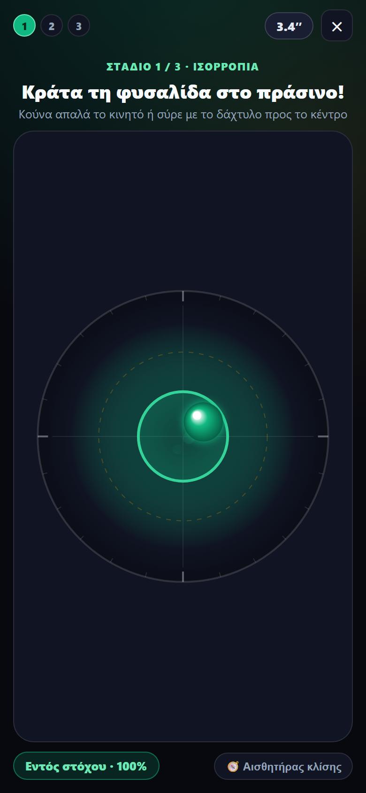
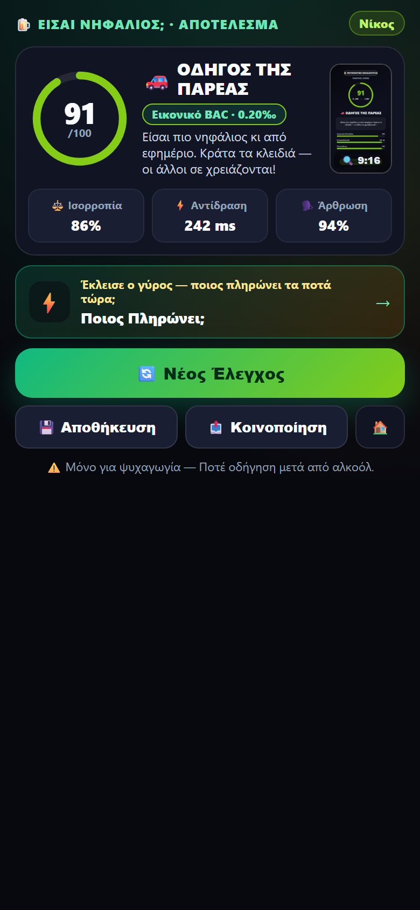

# 🍺 Είσαι Νηφάλιος; — Sober Check

**30″ Ελληνικό Τεστ Νηφαλιότητας για Solo & Παρέα — Ισορροπία Φυσαλίδας, Αντανακλαστικά με Παγίδα, Γλωσσοδέτης & 9:16 Story Κάρτα!**

*Greek 3-stage party sobriety challenge & 9:16 BAC card generator for Android & Web PWA — 100% on-device sensors & zero servers.*

[⬇️ Λήψη APK (`eisai-nifalios.apk`)](https://github.com/jemangr/eisai-nifalios-release/releases/latest/download/eisai-nifalios.apk) · [🌐 Παίξε Live (iPhone & Android)](https://jemangr.app/eisai-nifalios/) · [📜 Changelog](./CHANGELOG.md) · [🔒 Privacy Policy](./PRIVACY_POLICY.md)

---

## 📸 Screenshots

<table>
  <tr>
    <td align="center" width="20%">
       
      <b>1. Solo &amp; Παρέα (2–6)</b>
    </td>
    <td align="center" width="20%">
       
      <b>2. Ισορροπία 5″</b>
    </td>
    <td align="center" width="20%">
       
      <b>3. Αντανακλαστικά &amp; Παγίδα</b>
    </td>
    <td align="center" width="20%">
       
      <b>4. Κάρτα BAC · Save &amp; Share</b>
    </td>
    <td align="center" width="20%">
       
      <b>5. Κλειδιά vs Ταξί</b>
    </td>
  </tr>
</table>

---

## 🔥 Τι περιλαμβάνει;

* **⚖️ Στάδιο 1 — Ισορροπία Φυσαλίδας (5″):** Κράτα τη φωτεινή φυσαλίδα μέσα στον πράσινο στόχο με κλίση κινητού (`DeviceOrientation`) ή σύρσιμο με το δάχτυλο.
* **⚡ Στάδιο 2 — Αντανακλαστικά + Παγίδα (3 γύροι):** Πάτα αστραπιαία στο Πράσινο (ms) και κράτα φρένο όταν εμφανιστεί αιφνιδιαστικά η Πορτοκαλί Παγίδα!
* **🗣️ Στάδιο 3 — Γλωσσοδέτης Παρέας (4″):** Πες καθαρά έναν από τους 8 ελληνικούς γλωσσοδέτες στο μικρόφωνο (live waveform) ή πάτα τις 4 λέξεις στη σωστή σειρά.
* **🎴 Πιστοποιητικό Νηφαλιότητας 9:16:** Σκορ 0–100, εικονικό BAC (`‰`), χιουμοριστικό roast & rank + ξεχωριστά κουμπιά **💾 Αποθήκευση** (Gallery / PNG) & **📤 Κοινοποίηση** για TikTok / Reels / Stories.
* **🏆 Solo & Παρέα (2–6 άτομα):** Αναδεικνύει τον **🛡️ Κρατάει Κλειδιά** και τον **🚕 Παίρνει Ταξί**.
* **⚠️ Disclaimer:** Μόνο για διασκέδαση με παρέα — **ΠΟΤΕ οδήγηση μετά από κατανάλωση αλκοόλ.**

---

## 🌐 Περισσότερες Εφαρμοές από το `jemangr.app`

| App | Περιγραφή | Σύνδεσμος |
| :--- | :--- | :--- |
| 💀 **Έχεις Κότσια;** | Τέστ αντοχής & 6 σενάρια τρόμου/φάρσας με 9:16 βίντεο | [jemangr.app/test-kotsion](https://jemangr.app/test-kotsion/) |
| ⚡ **Ποιος Πληρώνει;** | Ελληνική multi-touch ρουλέτα παρέας με plot twists | [jemangr.app/poios-plironei](https://jemangr.app/poios-plironei/) |
| 🎲 **GameNight** | 62 ελληνικά παιχνίδια παρέας offline σε ένα κινητό | [jemangr.app/gamenight](https://jemangr.app/gamenight/) |
| 👻 **Pass & Play Terror** | Ασύμμετρο party horror & μυστήριο για 1–8 άτομα | [jemangr.app/pass-n-play-terror](https://jemangr.app/pass-n-play-terror/) |
| 🤬 **Binelik AI** | Ξέσπα σε 13+ ελληνικούς AI χαρακτήρες | [jemangr.app/binelik-ai](https://jemangr.app/binelik-ai/) |
| 🐱 **Mochi Pop!** | 8×8 block puzzle & 3D virtual pet γατάκι | [jemangr.app/mochi-pop](https://jemangr.app/mochi-pop/) |
| ⏳ **Secret Sanctum: Chrono Vault** | 3D ψυχολογικό escape room τρόμου | [jemangr.app/chrono-vault](https://jemangr.app/chrono-vault/) |

---

  Copyright © 2026 Giannis Oikonomakis (<a href="https://jemangr.app/el/">jemangr.app</a>). All Rights Reserved.

